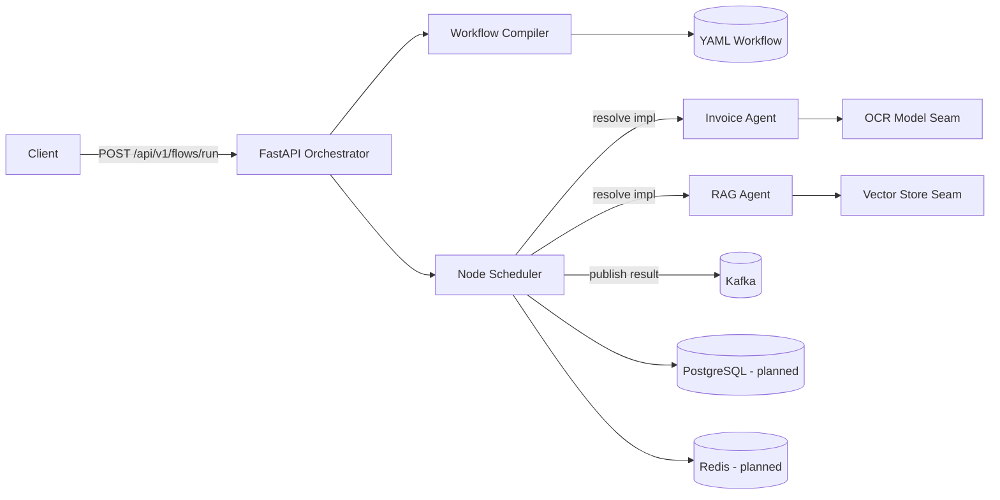
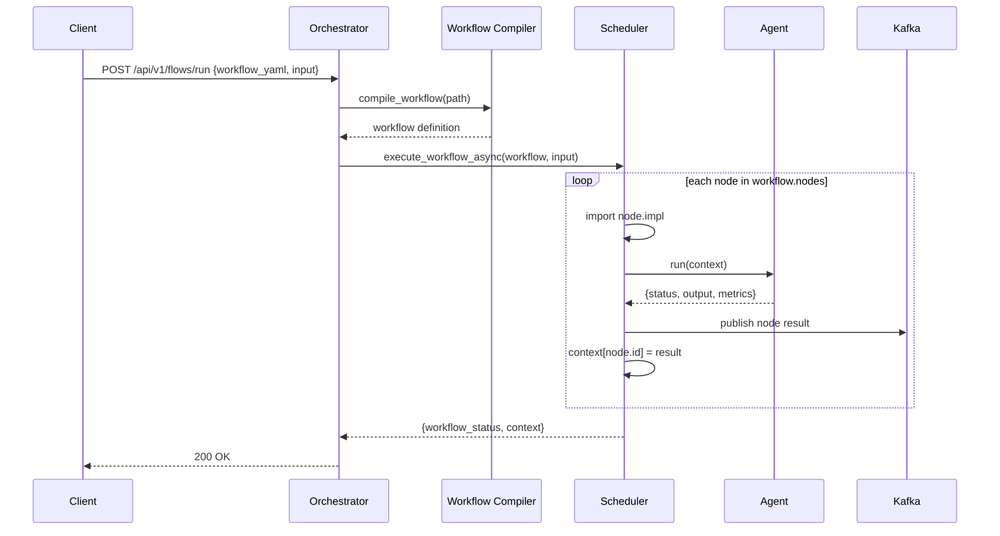

# AgentFlow — YAML-Driven AI Agent Orchestration

> **Build your own AI agents, compose them as data, and run them through a single orchestrator.**

AgentFlow is a reference framework for composing AI agents into declarative, YAML-defined workflows. A FastAPI orchestrator compiles a workflow, executes its nodes in order with retry handling, propagates a shared execution context between agents, and publishes every node result to Kafka. Agents are ordinary Python classes behind a uniform contract, so they are easy to add, test, swap, and reuse.

> **Project status:** Reference scaffold / prototype. The orchestration pipeline, agent contracts, YAML schema, and local infrastructure are in place. Agents are intentionally lightweight stubs, and several execution features are listed under [Roadmap](#roadmap). Read [Known Limitations](#known-limitations) before using this in production.

---

## Table of Contents

- [Why AgentFlow](#why-agentflow)
- [Core Concepts](#core-concepts)
- [Features](#features)
- [Architecture](#architecture)
- [Repository Structure](#repository-structure)
- [How It Works](#how-it-works)
- [Workflow Specification](#workflow-specification)
- [Agent Contract](#agent-contract)
- [API Reference](#api-reference)
- [Tech Stack](#tech-stack)
- [Getting Started](#getting-started)
- [Configuration](#configuration)
- [Adding Your Own Agent](#adding-your-own-agent)
- [Design Notes](#design-notes)
- [Known Limitations](#known-limitations)
- [Roadmap](#roadmap)
- [Author](#author)

---

## Why AgentFlow

Most agent demos hard-code a chain of model calls. AgentFlow explores the next step: describe an agent pipeline as **data**, then let an orchestrator resolve and execute each node. Flows become easier to version, review, diff, and reuse across teams. The orchestration layer knows nothing about invoices, RAG, or any specific domain — it only knows how to run nodes and pass context.

## Core Concepts

| Concept | Meaning |
| --- | --- |
| **Workflow** | A YAML document declaring metadata, an entry point, and an ordered list of nodes. |
| **Node** | One executable step with a unique `id`, a `type`, and an `impl` dotted path to a callable. |
| **Agent** | A Python class subclassing `BaseAgent` that implements `run(payload) -> dict`. |
| **Orchestrator** | The FastAPI service that compiles the workflow, schedules nodes, and returns the result. |
| **Scheduler** | The component that imports each node implementation, retries failures, and records output. |
| **Context** | A shared dictionary. Input is stored under `input`; each node result is stored under its node id. |
| **Envelope** | The standard agent return shape: `{"status", "output", "metrics"}`. |
| **Event topic** | Kafka topic `agentflow`, where node results are published for observability or replay. |

## Features

### Implemented

- FastAPI orchestrator with an OpenAPI/Swagger interface.
- YAML workflow loader (`compile_workflow`).
- Sequential node scheduler with configurable retry attempts and error logging.
- Dynamic resolution of node implementations from Python dotted paths.
- Shared context propagation between workflow nodes.
- Kafka producer integration for node results.
- Uniform `BaseAgent` contract and structured logging helper.
- Sample Invoice and RAG agents with pluggable model/storage seams.
- Docker Compose stack for PostgreSQL, Redis, ZooKeeper, and Kafka.
- Example workflow and node type taxonomy.

### Planned

- DAG execution (branching, parallel nodes, conditional edges).
- Strict Pydantic request/response models and YAML schema validation.
- Robust agent resolution supporting functions, classes, and bound methods.
- Kafka consumer workers and dead-letter topic handling.
- Persistence of workflow runs and node results in PostgreSQL.
- Redis-backed distributed locks and idempotency keys.
- Prometheus metrics and distributed tracing.
- Sandboxed execution with authentication and authorisation.
- Packaging (`pyproject.toml`), tests, and CI.

## Architecture



The orchestrator owns control flow. Agents own domain work. Infrastructure services provide messaging and persistence.

## Repository Structure

```text
agentflow/
├── agents/
│   ├── common/
│   │   ├── base_agent.py       # Agent contract
│   │   └── logger.py           # Structured logger factory
│   ├── invoice_agent/
│   │   ├── ocr_model.py        # OCR seam (stub)
│   │   └── worker.py           # InvoiceAgent
│   └── rag_agent/
│       ├── vector_store.py     # Retrieval seam (stub)
│       └── worker.py           # RAGAgent
├── examples/
│   └── flows/
│       └── demo_workflow.yaml  # Sample Invoice + RAG pipeline
├── infra/
│   └── docker-compose/
│       └── docker-compose.yml  # PostgreSQL, Redis, Kafka, ZooKeeper
├── libs/                       # Shared libraries (reserved)
├── models/                     # Local model artifacts (reserved)
├── monitoring/                 # Metrics and dashboards (reserved)
├── platform/
│   └── orchestrator/
│       ├── app.py              # FastAPI entry point
│       ├── compiler/
│       │   └── workflow_compiler.py
│       ├── msg_bus/
│       │   └── kafka_client.py
│       └── scheduler/
│           └── scheduler.py
├── requirements.txt
└── README.md
```

## How It Works



### Execution lifecycle

1. **Receive** — The client submits the path to a workflow YAML file together with an input object.
2. **Compile** — `compile_workflow` loads the YAML into a Python dictionary. No validation is performed yet.
3. **Initialise context** — The scheduler creates `{"input": <client input>}`.
4. **Iterate nodes** — Nodes are processed sequentially in the order they appear under `nodes`.
5. **Resolve implementation** — For each node, the dotted `impl` path is split at the final dot, imported dynamically, and invoked.
6. **Execute** — The callable receives the **entire context**, not just the input payload.
7. **Publish** — Successful results are published to the `agentflow` Kafka topic keyed by node id.
8. **Record** — The result is written back into the context under the node id for downstream nodes.
9. **Retry** — On failure, the node is retried up to two times with a one-second delay.
10. **Return** — After the last node, the orchestrator returns `{"workflow_status": "COMPLETED", "context": {...}}`. Exhausted nodes return `{"status": "FAILED"}`.

### Context propagation example

```text
Initial context:
{ "input": { "file": "invoices/sample.pdf", "query": "What is the invoice total?" } }

After invoice_start:
{
  "input": { ... },
  "invoice_start": { "status": "SUCCESS", "output": { "data": "..." }, "metrics": { "latency_ms": 120 } }
}

After rag_search:
{
  "input": { ... },
  "invoice_start": { ... },
  "rag_search": { "status": "SUCCESS", "output": { "results": [...] }, "metrics": { "latency_ms": 150 } }
}
```

Nodes can read any previously written key from the context. This is how one agent's output becomes another agent's input.

## Workflow Specification

Workflows are YAML documents. The example below is included in [`examples/flows/demo_workflow.yaml`](examples/flows/demo_workflow.yaml):

```yaml
version: '1.0'
id: demo_workflow
description: Demo workflow: Invoice + RAG agent integration
entry: invoice_start
nodes:
  - id: invoice_start
    type: InputHandler
    impl: agents.invoice_agent.worker.InvoiceAgent.run
    next: invoice_validate
  - id: invoice_validate
    type: Policy
    impl: agents.invoice_agent.worker.InvoiceAgent.run
    next: rag_search
  - id: rag_search
    type: InputHandler
    impl: agents.rag_agent.worker.RAGAgent.run
    next: workflow_end
  - id: workflow_end
    type: Output
    impl: agents.invoice_agent.worker.InvoiceAgent.run
```

### Schema

| Field | Required | Description |
| --- | --- | --- |
| `version` | Yes | Workflow schema version |
| `id` | Yes | Unique workflow identifier |
| `description` | No | Human-readable summary |
| `entry` | Yes | Entry node id |
| `nodes` | Yes | Ordered list of executable nodes |
| `nodes[].id` | Yes | Unique node identifier, also the context key |
| `nodes[].type` | Yes | Node category (`InputHandler`, `Policy`, `Output`, ...) |
| `nodes[].impl` | Yes | Dotted path to the callable implementation |
| `nodes[].next` | No | Intended successor (reserved for DAG execution) |

### Node type taxonomy

| Type | Purpose |
| --- | --- |
| `InputHandler` | Parse/validate the incoming request or external data. |
| `Policy` | Apply business rules, checks, or routing decisions. |
| `Transform` | Reshape data between agents. |
| `Output` | Format or persist the final response. |

`type` is currently descriptive metadata; it does not affect execution.

## Agent Contract

All agents inherit from `BaseAgent` and implement `run`:

```python
from agents.common.base_agent import BaseAgent

class MyAgent(BaseAgent):
    def __init__(self, context):
        super().__init__(context)

    def run(self, payload: dict) -> dict:
        return {
            "status": "SUCCESS",
            "output": {"result": "..."},
            "metrics": {"latency_ms": 42},
        }
```

The return envelope is deliberately small:

| Field | Purpose |
| --- | --- |
| `status` | Control flow signal (`SUCCESS`, `FAILED`, ...) |
| `output` | Downstream-consumable data |
| `metrics` | Observability data (latency, tokens, cost, ...) |

## API Reference

| Method | Endpoint | Description |
| --- | --- | --- |
| `POST` | `/api/v1/flows/run` | Compile and execute a workflow |
| `GET` | `/docs` | Swagger UI |
| `GET` | `/openapi.json` | OpenAPI schema |

### Request body

```json
{
  "workflow_yaml": "path/to/workflow.yaml",
  "input": {
    "file": "invoices/sample.pdf",
    "query": "What is the invoice total?"
  }
}
```

### Response

```json
{
  "workflow_status": "COMPLETED",
  "context": {
    "input": {"file": "invoices/sample.pdf"},
    "invoice_start": {"status": "SUCCESS", "output": {}, "metrics": {}}
  }
}
```

### Errors

| Status | Cause |
| --- | --- |
| `400` | `workflow_yaml` missing from the request body. |
| `500` | Unhandled error while compiling the YAML (for example, file not found). |

## Tech Stack

| Area | Technology |
| --- | --- |
| API | FastAPI, Uvicorn |
| Workflow definition | YAML, PyYAML |
| Messaging | Apache Kafka, `confluent-kafka` |
| Cache / coordination | Redis (planned) |
| Persistence | PostgreSQL, `psycopg2` (planned) |
| Metrics | `prometheus-client` (planned) |
| Model runtime | OpenVINO (planned/driver dependency) |
| Local infrastructure | Docker Compose |

## Getting Started

### Prerequisites

- Python 3.10+
- Docker Desktop with Docker Compose
- A working Kafka broker (provided by the Compose stack)

### 1. Start local infrastructure

```bash
cd infra/docker-compose
docker compose up -d
```

This starts PostgreSQL (`5432`), Redis (`6379`), ZooKeeper (`2181`), and Kafka (`9092`).

### 2. Install Python dependencies

From the repository root:

```bash
python -m venv .venv
```

```powershell
# Windows (PowerShell)
.\.venv\Scripts\Activate.ps1
```

```bash
# macOS / Linux
source .venv/bin/activate
```

```bash
pip install -r requirements.txt
```

### 3. Start the orchestrator

The orchestrator uses local module imports (`compiler`, `scheduler`, `msg_bus`), so start it from its own directory while keeping the repository root on `PYTHONPATH`:

```bash
cd platform/orchestrator
```

```powershell
# Windows (PowerShell)
$env:PYTHONPATH = (Resolve-Path ..\..).Path
uvicorn app:app --reload --port 8000
```

```bash
# macOS / Linux
PYTHONPATH=../.. uvicorn app:app --reload --port 8000
```

Swagger UI: `http://localhost:8000/docs`

### 4. Trigger the example workflow

The `workflow_yaml` path is resolved relative to the orchestrator process.

```powershell
# Windows (PowerShell)
$body = @{
  workflow_yaml = "../../examples/flows/demo_workflow.yaml"
  input = @{ file = "invoices/sample.pdf"; query = "What is the invoice total?" }
} | ConvertTo-Json

Invoke-RestMethod -Method Post -Uri "http://localhost:8000/api/v1/flows/run" `
  -ContentType "application/json" -Body $body
```

```bash
# macOS / Linux
curl -X POST http://localhost:8000/api/v1/flows/run \
  -H "Content-Type: application/json" \
  -d '{
    "workflow_yaml": "../../examples/flows/demo_workflow.yaml",
    "input": {"file": "invoices/sample.pdf", "query": "What is the invoice total?"}
  }'
```

> The example illustrates the intended end-to-end contract. See [Known Limitations](#known-limitations) before expecting the bundled YAML to execute unchanged.

## Configuration

| Setting | Location | Default |
| --- | --- | --- |
| Kafka bootstrap servers | `platform/orchestrator/msg_bus/kafka_client.py` | `localhost:9092` |
| Kafka topic | `platform/orchestrator/msg_bus/kafka_client.py` | `agentflow` |
| PostgreSQL database/user/password | `infra/docker-compose/docker-compose.yml` | `agentflow` / `agentflow` / `agentflow` |
| Retry attempts | `platform/orchestrator/scheduler/scheduler.py` | `2` |
| Retry delay | `platform/orchestrator/scheduler/scheduler.py` | `1s` |
| API port | Uvicorn CLI | `8000` |

The Compose credentials are development defaults only. Replace them and move configuration into environment variables before deploying.

## Adding Your Own Agent

1. Create a package under `agents/`, e.g. `agents/summary_agent/`.
2. Implement a class that subclasses `BaseAgent` and returns the standard envelope.
3. Reference it from a workflow using a dotted path.
4. Publish results through the returned `output` or a side effect.

```python
# agents/summary_agent/worker.py
from agents.common.base_agent import BaseAgent
from agents.common.logger import get_logger

logger = get_logger("SummaryAgent")

class SummaryAgent(BaseAgent):
    def run(self, payload: dict) -> dict:
        source = payload.get("input", {}).get("text", "")
        summary = source[:200]
        logger.info("Summarised %d characters", len(source))
        return {
            "status": "SUCCESS",
            "output": {"summary": summary},
            "metrics": {"input_chars": len(source)},
        }
```

Then add a node to a workflow:

```yaml
nodes:
  - id: summarise
    type: Transform
    impl: agents.summary_agent.worker.SummaryAgent
```

> When wiring a class this way, the scheduler must instantiate it. The current resolver treats `impl` as a module-level callable; see the resolver limitation below.

## Design Notes

- **Dynamic dispatch** — Node implementations are referenced by dotted path, which keeps the YAML declarative but couples execution to the deployed Python import graph.
- **Retry semantics** — Retries are immediate and in-process. Production flows should distinguish retryable failures (network, throttling) from permanent ones and use exponential backoff with jitter.
- **Context growth** — Every node result is retained in the context. Long workflows should prune intermediate payloads or reference external storage.
- **Idempotency** — Kafka publication happens after node execution. Use deterministic node ids and idempotency keys to make replays safe.
- **Observability** — Node results already include a `metrics` envelope; wiring Prometheus and OpenTelemetry is a natural next step.
- **Security** — Workflow files and implementation paths are trusted today. Never expose this API to untrusted users without sandboxing, path allow-listing, and authentication.

## Known Limitations

- **Agent stubs:** `OCRModel.extract_text` and `VectorStore.search` return deterministic placeholder data.
- **Resolver mismatch:** The scheduler imports everything before the final dot as a module. References such as `agents.invoice_agent.worker.InvoiceAgent.run` therefore need a resolver that understands classes and bound methods.
- **Payload shape:** The scheduler passes the whole context to the node callable, while the sample agents expect a flat payload (`file`, `query`). Adapters will be needed.
- **Sequential execution only:** `next`, `entry`, and node `type` are parsed but not yet used for branching or graph traversal.
- **No validation:** The API accepts an arbitrary path and dynamic import target, which is an intentional RCE surface in this prototype.
- **Legacy infrastructure:** The Compose file uses the deprecated `wurstmeister` Kafka and ZooKeeper images.
- **No tests or packaging:** There is no `pyproject.toml`, automated test suite, or CI pipeline yet.

## Roadmap

- [ ] Support `module.function`, `module.Class.method`, and agent classes in the resolver.
- [ ] Replace `wurstmeister` images with maintained Kafka (KRaft) images.
- [ ] Add Pydantic request models and JSON Schema validation for workflows.
- [ ] Persist runs, node results, and audit events in PostgreSQL.
- [ ] Add Redis-based coordination and idempotency.
- [ ] Add Prometheus metrics, health checks, and structured tracing.
- [ ] Add authentication, path allow-listing, and a sandboxed execution model.
- [ ] Add tests, packaging, and GitHub Actions CI.

## Author

**Sushant Buche**

- GitHub: [@SushantBuche-107](https://github.com/SushantBuche-107)

## License

No license has been added yet. Add one before accepting external contributions.
