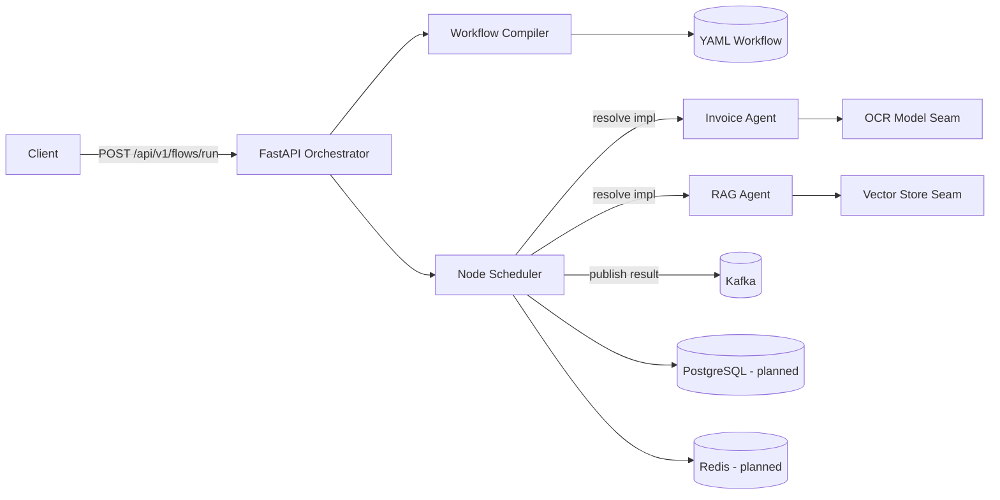
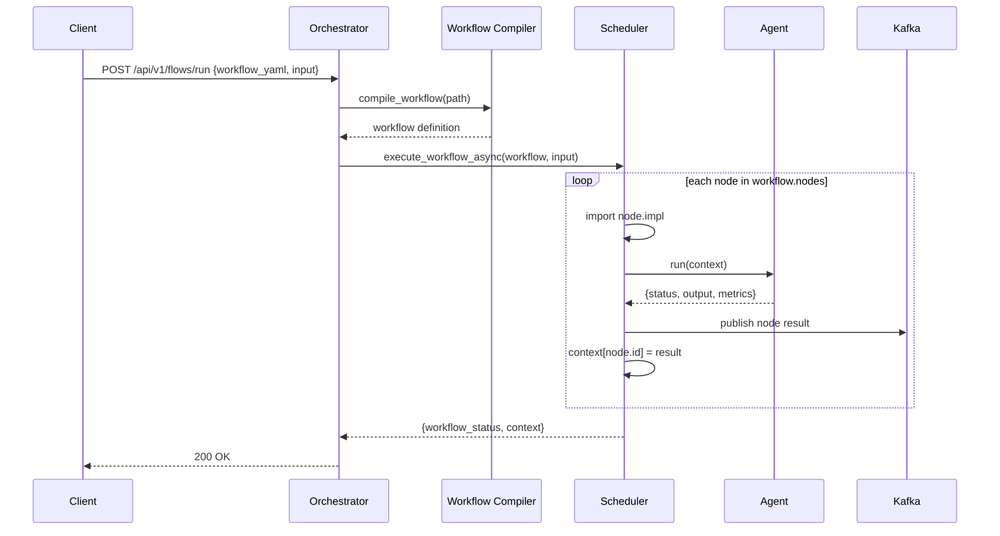

# BYOA — Build Your Own AI Agent

A reference framework for composing AI agents into declarative, YAML-defined workflows. BYOA provides a FastAPI orchestrator that compiles a workflow, executes its nodes sequentially with retry handling, propagates a shared execution context, and publishes node results to Kafka. Agents are ordinary Python classes with a uniform contract, making them easy to add, test, and replace.

> **Project status:** Reference scaffold / prototype. The orchestration pipeline, agent contracts, YAML schema, and local infrastructure are in place. Agents are intentionally lightweight stubs, and several execution features are listed under [Roadmap](#roadmap). Review [Known Limitations](#known-limitations) before using this in a production setting.

## Overview

Most agent demos hard-code a chain of calls. BYOA explores the next step: describing an agent pipeline as data, then letting an orchestrator resolve and execute each node. This makes flows easier to version, review, and reuse across teams.

The framework is organised around four ideas:

1. **Workflow as data** — A YAML document declares the nodes, their implementation targets, and execution order.
2. **Pluggable agents** — Every agent subclasses `BaseAgent` and exposes `run(payload) -> dict`, so the orchestrator does not need agent-specific knowledge.
3. **Context propagation** — Each node receives the shared context; its result is written back under the node id for downstream nodes.
4. **Event publication** — Node results are emitted to Kafka for observability, replay, or downstream consumers.

## Features

### Implemented

- FastAPI orchestrator with an OpenAPI/Swagger interface.
- YAML workflow loader (`compile_workflow`).
- Sequential node scheduler with configurable retry attempts and error logging.
- Dynamic resolution of node implementations from dotted paths.
- Shared context between workflow nodes.
- Kafka producer integration for node results.
- Uniform `BaseAgent` contract and structured logging helper.
- Sample Invoice and RAG agents with pluggable model/storage seams.
- Docker Compose stack for PostgreSQL, Redis, ZooKeeper, and Kafka.
- Example workflow and node type taxonomy.

### Planned

- DAG execution (branching, parallel nodes, conditional edges).
- Strict Pydantic request/response models and YAML schema validation.
- Robust agent resolution that supports both functions and agent classes.
- Kafka consumer workers and dead-letter topic handling.
- Persistence of workflow runs and node results in PostgreSQL.
- Redis-backed distributed locks and idempotency keys.
- Prometheus metrics and distributed tracing.
- Sandboxed execution with authentication and authorisation.
- Packaging (`pyproject.toml`), tests, and CI.

## Architecture



The orchestrator owns control flow. Agents own domain work. Infrastructure services provide messaging and persistence.

## Repository Structure

```text
byoa/
├── agents/
│   ├── common/
│   │   ├── base_agent.py       # Agent contract
│   │   └── logger.py           # Structured logger factory
│   ├── invoice_agent/
│   │   ├── ocr_model.py        # OCR seam (stub)
│   │   └── worker.py           # InvoiceAgent
│   └── rag_agent/
│       ├── vector_store.py     # Retrieval seam (stub)
│       └── worker.py           # RAGAgent
├── examples/
│   └── flows/
│       └── demo_workflow.yaml  # Sample Invoice + RAG pipeline
├── infra/
│   └── docker-compose/
│       └── docker-compose.yml  # PostgreSQL, Redis, Kafka, ZooKeeper
├── libs/                       # Shared libraries (reserved)
├── models/                     # Local model artifacts (reserved)
├── monitoring/                 # Metrics and dashboards (reserved)
├── platform/
│   └── orchestrator/
│       ├── app.py              # FastAPI entry point
│       ├── compiler/
│       │   └── workflow_compiler.py
│       ├── msg_bus/
│       │   └── kafka_client.py
│       └── scheduler/
│           └── scheduler.py
├── requirements.txt
└── README.md
```

## How It Works



1. The client submits the path to a workflow YAML file together with an input object.
2. The compiler loads and parses the YAML into a Python dictionary.
3. The scheduler iterates over `workflow.nodes` in order.
4. For each node, the implementation path is imported dynamically and invoked with the current context.
5. Successful results are published to the `byoa` Kafka topic and stored in the context under the node id.
6. Failures are retried up to twice with a one-second backoff; exhausted nodes return `{"status": "FAILED"}`.
7. The orchestrator returns the completed context.

## Workflow Specification

Workflows are YAML documents. The example below is included in [`examples/flows/demo_workflow.yaml`](examples/flows/demo_workflow.yaml):

```yaml
version: '1.0'
id: demo_workflow
description: Demo workflow: Invoice + RAG agent integration
entry: invoice_start
nodes:
  - id: invoice_start
    type: InputHandler
    impl: agents.invoice_agent.worker.InvoiceAgent.run
    next: invoice_validate
  - id: invoice_validate
    type: Policy
    impl: agents.invoice_agent.worker.InvoiceAgent.run
    next: rag_search
  - id: rag_search
    type: InputHandler
    impl: agents.rag_agent.worker.RAGAgent.run
    next: workflow_end
  - id: workflow_end
    type: Output
    impl: agents.invoice_agent.worker.InvoiceAgent.run
```

| Field | Required | Description |
| --- | --- | --- |
| `version` | Yes | Workflow schema version |
| `id` | Yes | Unique workflow identifier |
| `description` | No | Human-readable summary |
| `entry` | Yes | Entry node id |
| `nodes` | Yes | Ordered list of executable nodes |
| `nodes[].id` | Yes | Unique node identifier, also the context key |
| `nodes[].type` | Yes | Node category (`InputHandler`, `Policy`, `Output`, ...) |
| `nodes[].impl` | Yes | Dotted path to the callable implementation |
| `nodes[].next` | No | Intended successor (reserved for DAG execution) |

## Agent Contract

All agents inherit from `BaseAgent` and implement `run`:

```python
from agents.common.base_agent import BaseAgent

class MyAgent(BaseAgent):
    def __init__(self, context):
        super().__init__(context)

    def run(self, payload: dict) -> dict:
        return {
            "status": "SUCCESS",
            "output": {"result": "..."},
            "metrics": {"latency_ms": 42},
        }
```

The return envelope is deliberately small: `status` for control flow, `output` for downstream consumption, and `metrics` for observability.

## API Reference

| Method | Endpoint | Description |
| --- | --- | --- |
| `POST` | `/api/v1/flows/run` | Compile and execute a workflow |
| `GET` | `/docs` | Swagger UI |
| `GET` | `/openapi.json` | OpenAPI schema |

Request body:

```json
{
  "workflow_yaml": "path/to/workflow.yaml",
  "input": {
    "file": "invoices/sample.pdf",
    "query": "What is the invoice total?"
  }
}
```

Response:

```json
{
  "workflow_status": "COMPLETED",
  "context": {
    "input": {"file": "invoices/sample.pdf"},
    "invoice_start": {"status": "SUCCESS", "output": {}, "metrics": {}}
  }
}
```

## Tech Stack

| Area | Technology |
| --- | --- |
| API | FastAPI, Uvicorn |
| Workflow definition | YAML, PyYAML |
| Messaging | Apache Kafka, `confluent-kafka` |
| Cache / coordination | Redis (planned) |
| Persistence | PostgreSQL, `psycopg2` (planned) |
| Metrics | `prometheus-client` (planned) |
| Model runtime | OpenVINO (planned/driver dependency) |
| Local infrastructure | Docker Compose |

## Getting Started

### Prerequisites

- Python 3.10+
- Docker Desktop with Docker Compose
- A working Kafka broker (provided by the Compose stack)

### 1. Start local infrastructure

```bash
cd infra/docker-compose
docker compose up -d
```

This starts PostgreSQL (`5432`), Redis (`6379`), ZooKeeper (`2181`), and Kafka (`9092`).

### 2. Install Python dependencies

From the repository root:

```bash
python -m venv .venv
```

```powershell
# Windows (PowerShell)
.\.venv\Scripts\Activate.ps1
```

```bash
# macOS / Linux
source .venv/bin/activate
```

```bash
pip install -r requirements.txt
```

### 3. Start the orchestrator

The orchestrator uses local module imports (`compiler`, `scheduler`, `msg_bus`), so start it from its own directory while keeping the repository root on `PYTHONPATH`:

```bash
cd platform/orchestrator
```

```powershell
# Windows (PowerShell)
$env:PYTHONPATH = (Resolve-Path ..\..).Path
uvicorn app:app --reload --port 8000
```

```bash
# macOS / Linux
PYTHONPATH=../.. uvicorn app:app --reload --port 8000
```

Swagger UI: `http://localhost:8000/docs`

### 4. Trigger the example workflow

The `workflow_yaml` path is resolved relative to the orchestrator process.

```powershell
# Windows (PowerShell)
$body = @{
  workflow_yaml = "../../examples/flows/demo_workflow.yaml"
  input = @{ file = "invoices/sample.pdf"; query = "What is the invoice total?" }
} | ConvertTo-Json

Invoke-RestMethod -Method Post -Uri "http://localhost:8000/api/v1/flows/run" `
  -ContentType "application/json" -Body $body
```

```bash
# macOS / Linux
curl -X POST http://localhost:8000/api/v1/flows/run \
  -H "Content-Type: application/json" \
  -d '{
    "workflow_yaml": "../../examples/flows/demo_workflow.yaml",
    "input": {"file": "invoices/sample.pdf", "query": "What is the invoice total?"}
  }'
```

> The example illustrates the intended end-to-end contract. See the resolver limitation below before expecting the bundled YAML to execute unchanged.

## Configuration

| Setting | Location | Default |
| --- | --- | --- |
| Kafka bootstrap servers | `platform/orchestrator/msg_bus/kafka_client.py` | `localhost:9092` |
| Kafka topic | `platform/orchestrator/msg_bus/kafka_client.py` | `byoa` |
| PostgreSQL database/user/password | `infra/docker-compose/docker-compose.yml` | `byoa` / `byoa` / `byoa` |
| Retry attempts | `platform/orchestrator/scheduler/scheduler.py` | `2` |
| API port | Uvicorn CLI | `8000` |

The Compose credentials are development defaults only. Replace them and move configuration into environment variables before deploying.

## Design Notes

- **Dynamic dispatch** — Node implementations are referenced by dotted path, which keeps the YAML declarative but couples execution to the deployed Python import graph.
- **Retry semantics** — Retries are immediate and in-process. Production flows should distinguish retryable failures (network, throttling) from permanent ones and use exponential backoff with jitter.
- **Context growth** — Every node result is retained in the context. Long workflows should prune intermediate payloads or reference external storage.
- **Idempotency** — Kafka publication happens after node execution. Use deterministic node ids and idempotency keys to make replays safe.
- **Observability** — Node results already include a `metrics` envelope; wiring Prometheus and OpenTelemetry is a natural next step.
- **Security** — Workflow files and implementation paths are trusted today. Never expose this API to untrusted users without sandboxing, path allow-listing, and authentication.

## Known Limitations

- **Agent stubs:** `OCRModel.extract_text` and `VectorStore.search` return deterministic placeholder data.
- **Resolver mismatch:** The scheduler imports everything before the final dot as a module. References such as `agents.invoice_agent.worker.InvoiceAgent.run` therefore need a resolver that understands classes and bound methods.
- **Sequential execution only:** `next`, `entry`, and node `type` are parsed but not yet used for branching or graph traversal.
- **No validation:** The API accepts an arbitrary path and dynamic import target, which is an intentional RCE surface in this prototype.
- **Legacy infrastructure:** The Compose file uses the deprecated `wurstmeister` Kafka and ZooKeeper images.
- **No tests or packaging:** There is no `pyproject.toml`, automated test suite, or CI pipeline yet.

## Roadmap

- [ ] Support `module.function`, `module.Class.method`, and agent classes in the resolver.
- [ ] Replace `wurstmeister` images with maintained Kafka (KRaft) images.
- [ ] Add Pydantic request models and JSON Schema validation for workflows.
- [ ] Persist runs, node results, and audit events in PostgreSQL.
- [ ] Add Redis-based coordination and idempotency.
- [ ] Add Prometheus metrics, health checks, and structured tracing.
- [ ] Add authentication, path allow-listing, and a sandboxed execution model.
- [ ] Add tests, packaging, and GitHub Actions CI.

## Author

**Sushant Buche**

- GitHub: [@SushantBuche-107](https://github.com/SushantBuche-107)
